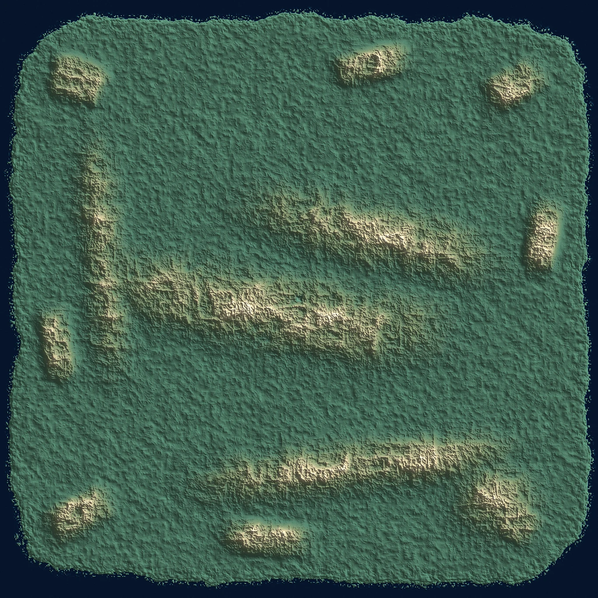

# Q26 Showcase

By **Bill Kosche - William Kosche**.

**Three project hubs and an original map sample.** The showcase covers large terrain and multi-map work in Q26, course design in Chaos Circuits, and authored terrain and roads in Assault Knights.

| Hub | What to explore |
| --- | --- |
| [Q26](docs/q26.html) | A native-scale terrain run spanning 131.072 km on each horizontal axis, the 48-unit multi-map tests and a pair of editable maps. |
| [Chaos Circuits](docs/chaos-circuits.html) | Tidal Braid and Glacier Switch, their 3D stunt geometry, route checks and split lanes. |
| [Assault Knights](docs/assault-knights.html) | The 10 km Aurora Canyon road plan, its fork families and its conversion into Q26 terrain tiles. |

[Open the showcase](docs/index.html) from a local copy. The site also runs on GitHub Pages from the `/docs` folder of the selected branch. All pages use relative links and require no build, login or external services.

[Read the development posts](docs/development.html) for the build history and test details.

## Try Relay Rooms

1. Download the [map pack](docs/downloads/q26-relay-rooms-0.1.0.pk3) or the [editable source ZIP](docs/downloads/q26-relay-rooms-source-0.1.0.zip).
2. Place the map pack in the game directory of a test profile on a compatible Quake III–based client you are entitled to use.
3. In the client console, run `/map q26_relay_hall`. Walk onto a coloured pad to try the teleport route. Use `/map q26_relay_annex` for the second map.

See the [sample guide](examples/relay-rooms/README.md), [build results](docs/downloads/relay-rooms-results.json) and [SHA-256 checksums](docs/downloads/SHA256SUMS.txt). The sample includes a map rotation config and a Q26 static-subworld example. Both coloured teleport pads passed an in-game movement check in the Windows OpenGL client.

The map pack contains original maps and materials. Obtain any compatible engine and game data separately and follow their licence terms. See [licences and credits](NOTICE.md) and the [0.1.0 release notes](CHANGELOG.md).
